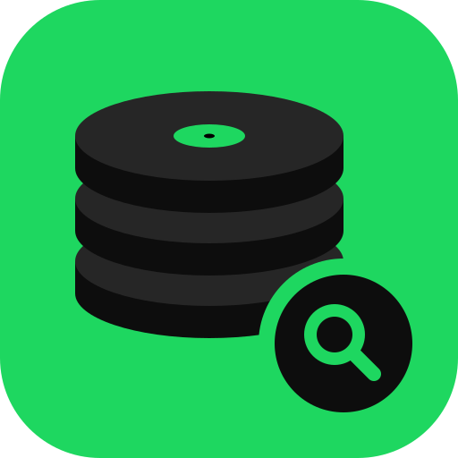
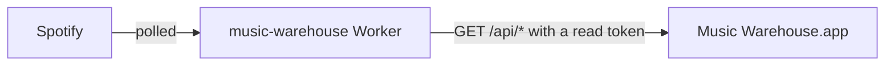

<div align="center">

<h1>music-warehouse-gui</h1>
<p><strong>A native macOS app for browsing your Spotify listening history.</strong></p>
<p>
<a href="LICENSE"></a>
<a href="https://www.rust-lang.org"></a>

<a href="https://github.com/rcnsh/music-warehouse#clients"></a>
</p>
<p><a href="#features">Features</a> · <a href="#quick-start">Quick start</a> · <a href="#install">Install</a> · <a href="#configuration">Configuration</a> · <a href="#keyboard-shortcuts">Shortcuts</a> · <a href="#development">Development</a></p>
</div>

Music Warehouse is a native macOS app for exploring the Spotify listening
history stored by a [music-warehouse](https://github.com/rcnsh/music-warehouse)
Cloudflare Worker. It shows every stored play, daily counts, top artists and
songs, yearly summaries and what is playing now. The Worker does the polling,
storage and aggregation; the app only displays data, with a read-only token.
Built in Rust with [GPUI](https://www.gpui.rs) and
[gpui-component](https://github.com/longbridge/gpui-component).

> [!NOTE]
> This app needs your own music-warehouse deployment. Set one up first by
> following the warehouse's
> [quick start](https://github.com/rcnsh/music-warehouse#quick-start).

<!-- TODO: add screenshot/GIF at docs/screenshot.png -->
<!--  -->

## Features

| Page | Shortcut | What it shows |
|---|---|---|
| **History** | <kbd>⌘</kbd><kbd>1</kbd> | Every stored play in local time with album art, loaded page by page as you scroll. See [History](#history) below. |
| **Overview** | <kbd>⌘</kbd><kbd>2</kbd> | Plays per day, top artists and top songs for 7 days, 30 days, a year or a custom range, beside Spotify's own live top lists with artist photos and album art. |
| **On Repeat** | <kbd>⌘</kbd><kbd>3</kbd> | Songs and albums played far more than usual over the last two weeks, with each song's plays per day. |
| **On This Day** | <kbd>⌘</kbd><kbd>4</kbd> | The most-played songs on this date in each earlier year, for today or any day you pick. |
| **Top Albums** | <kbd>⌘</kbd><kbd>5</kbd> | The most-played albums, all time and per year. |
| **Top Over Time** | <kbd>⌘</kbd><kbd>6</kbd> | The leading artists per year or quarter, and how each one's share of listening rose and fell. |
| **Rhythm** | <kbd>⌘</kbd><kbd>7</kbd> | Listening streaks and when in the day and week you listen, all time or per year, in each era's local time. |
| **Eras** | <kbd>⌘</kbd><kbd>8</kbd> | How listening changed between the Worker's two configured eras (a move to another city, say), against how much it usually changes. |
| **Wrapped** | <kbd>⌘</kbd><kbd>9</kbd> | A Spotify-Wrapped-style summary of each year or this year so far: totals, top artists, songs and albums, discoveries, when you listened and month by month. |
| **Concerts** | <kbd>⌘</kbd><kbd>0</kbd> | Upcoming shows for the artists you play most, in the regions the Worker is configured for. |
| **Artist and Track pages** | click a name | All-time plays, listening time, first and last play, plays per day over the last 30 days, 90 days or year, plays per month and (for artists) their most-played songs. Opened by clicking an artist or song anywhere in the app, including Wrapped, Top Over Time and Concerts. |

Across the app:

- **Now playing** strip, polled every 20–30 seconds. It backs off on errors
  and pauses while the window is hidden.
- **Command palette** (<kbd>⌘</kbd><kbd>K</kbd>) with every command. It also
  searches the stored history for artists and songs by name as you type.
- **Back** (<kbd>⌘</kbd><kbd>[</kbd> or the arrow in the top bar) returns to
  the previous page.
- The window reopens where you left it, on the same page and ranges.
- View › Appearance (or <kbd>⌘</kbd><kbd>K</kbd>, "theme") picks light, dark
  or Match System.

### History

- <kbd>⌘</kbd><kbd>F</kbd> searches the whole history by track, artist or
  album, ignoring case and accents, from two characters (needs a Worker with
  `q` on `/api/plays`). <kbd>Enter</kbd> searches at once and moves to the
  list; <kbd>j</kbd> and <kbd>k</kbd> move.
- **Search from date** limits a search to plays since a day, and
  <kbd>⌘</kbd><kbd>G</kbd> (**Go to date**) sets the day it searches back
  from.
- New plays appear at the top within five minutes of the Worker storing them,
  while the window is visible. Plays Spotify reports that the Worker has not
  stored yet show above them, marked "Not saved yet".
- A "From" column names the album, playlist or artist page each play started
  from, and a song's first ever play is marked.
- Selecting a play shows its details, including which play of the song it was
  ("37th play"). <kbd>o</kbd> opens it in Spotify,
  <kbd>⌘</kbd><kbd>C</kbd> copies it, and its song and artists open their
  pages.
- **Every play of this song** (or **Show every play** on an Artist or Track
  page) narrows History to one song or artist, shown as a removable chip.
  Search and dates still apply inside it.
- **Export CSV…** (<kbd>⇧</kbd><kbd>⌘</kbd><kbd>E</kbd>, the File menu, the
  palette or the toolbar button) saves the plays matching the current song,
  artist, search and dates to a file you choose, streamed straight to disk
  with progress in the status bar.

### Overview

Plays are bucketed by the Worker in the system timezone. Each range is
fetched once per session, so switching back is instant;
<kbd>⌘</kbd><kbd>R</kbd> fetches it again. Clicking a day opens it in
History; artists and songs open their pages.

> [!TIP]
> History and Overview read stored rows, so they keep working when the
> Worker's Spotify grant has expired. Only the now playing strip, Spotify's
> top lists and History's not-yet-saved plays need it.

## How it works



The app reads the Worker's `/api/*` routes, all with
`Authorization: Bearer <token>`. It has no method for any admin route.

<details>
<summary>Routes the app uses</summary>

| Route | Used for |
|---|---|
| `GET /api/plays` | History, paging with `before` and new rows with `after`; `q`, `track_id` and `artist_id` narrow it |
| `GET /api/plays.csv` | Export CSV…, with the same filters and bounds as History |
| `GET /api/daily` | Overview chart, and with `track_id` or `artist_id` the Artist and Track pages' plays per day |
| `GET /api/top-artists` | Overview top artists |
| `GET /api/top-tracks` | Overview top songs |
| `GET /api/top` | Spotify's live top lists |
| `GET /api/now-playing` | Now playing strip |
| `GET /api/recently-played` | History's not-yet-saved plays |
| `GET /api/artist`, `GET /api/track` | Artist and Track pages |
| `GET /api/on-this-day` | On This Day |
| `GET /api/stats/{on-repeat,rhythm,top-over-time,eras,albums}` | The Stats pages |
| `GET /api/wrapped/ranges`, `GET /api/wrapped` | Wrapped |
| `GET /api/concerts` | Concerts, in whatever regions the Worker is configured for |
| `GET /api/search` | <kbd>⌘</kbd><kbd>K</kbd> artist and song search |

</details>

Signing in uses the Worker's native-app flow (see
[Signing in with Spotify](https://github.com/rcnsh/music-warehouse#signing-in-with-spotify)):

1. The app listens on `http://127.0.0.1:<random port>/callback`.
2. It opens `/auth/login` in the browser with a PKCE challenge.
3. It exchanges the returned code at `POST /auth/token` for a read
   [device token](https://github.com/rcnsh/music-warehouse#device-tokens).

Nothing is listening once the browser returns, after five minutes, or when
you cancel.

## Requirements

- A deployed music-warehouse Worker
  ([quick start](https://github.com/rcnsh/music-warehouse#quick-start)).
- Either the Spotify account that owns it, or a read token such as
  `READ_TOKEN`.
- macOS 12 or later, on Apple Silicon or Intel.

## Quick start

1. [Install a release](#install), or build from source with a stable Rust
   toolchain:

   ```bash
   cargo run --release
   ```

2. On first launch, enter the Worker URL (for example
   `https://music-warehouse.<you>.workers.dev`).
3. Click **Sign in with Spotify** and approve in your browser. The Worker
   mints a read token for this Mac (listed as `macOS app (<computer name>)`)
   and the app saves it.

   Or paste `READ_TOKEN` or another read token, click **Test connection**,
   then **Save**.

Tokens from signing in expire after 90 days. When the Worker stops accepting
the saved token, the app says so; sign in again from Settings
(<kbd>⌘</kbd><kbd>,</kbd>).

<details>
<summary>Finding an existing Worker's URL with the <code>cf</code> CLI</summary>

```bash
cf workers list                                       # find the Worker's name
cf workers secrets list --worker music-warehouse      # check READ_TOKEN is set
```

The URL to enter is the Worker's custom domain, or
`<name>.<subdomain>.workers.dev` if it has none.

</details>

## Install

Download the zip from the latest
[GitHub release](https://github.com/rcnsh/music-warehouse-gui/releases), unzip
it and move **Music Warehouse.app** to Applications. It is a universal app for
Apple Silicon and Intel Macs on macOS 12 or later. If there is no release
yet, build from source as in [Quick start](#quick-start).

Releases are signed with a Developer ID and notarized by Apple, so the app
opens without a Gatekeeper prompt.

## Configuration

Everything is set in the app's setup screen (<kbd>⌘</kbd><kbd>,</kbd>). There
are no config flags for normal builds.

| What | Where |
|---|---|
| Worker URL | `~/Library/Application Support/music-warehouse-gui/config.json` (`worker_url`) |
| Read token (signed in or pasted) | macOS Keychain, service `music-warehouse-gui`, account `READ_TOKEN`. Never written to disk. |
| Window frame, last page, Overview ranges, appearance | `~/Library/Application Support/music-warehouse-gui/ui-state.json` |

Delete `config.json` to get the first-run setup screen again. A broken
`ui-state.json` only resets window and view state.

> [!WARNING]
> Use `READ_TOKEN`, not `ADMIN_TOKEN`. Setup probes the Worker and refuses a
> token with admin access.

Each rebuild of an ad-hoc-signed binary has a new signature, so macOS asks
again before releasing the Keychain item. "Always Allow" covers one build.

## Keyboard shortcuts

| Shortcut | Action |
|---|---|
| <kbd>⌘</kbd><kbd>1</kbd> … <kbd>⌘</kbd><kbd>9</kbd>, <kbd>⌘</kbd><kbd>0</kbd> | History, Overview, On Repeat, On This Day, Top Albums, Top Over Time, Rhythm, Eras, Wrapped, Concerts |
| <kbd>⌘</kbd><kbd>[</kbd> | Back to the previous page |
| <kbd>⌘</kbd><kbd>K</kbd> | Command palette, and artist and song search |
| <kbd>⌘</kbd><kbd>F</kbd> | Search History |
| <kbd>⌘</kbd><kbd>G</kbd> | Go to date |
| <kbd>⇧</kbd><kbd>⌘</kbd><kbd>E</kbd> | Export CSV… |
| <kbd>⌘</kbd><kbd>R</kbd> | Refresh |
| <kbd>⌘</kbd><kbd>,</kbd> | Settings |
| <kbd>⌘</kbd><kbd>Q</kbd> | Quit |
| <kbd>j</kbd> / <kbd>k</kbd> | Move down / up in a list |
| <kbd>o</kbd> | Open the selected play in Spotify |
| <kbd>⌘</kbd><kbd>C</kbd> | Copy the selected play |

## Development

You need a Mac with a stable Rust toolchain (edition 2024) and the Xcode
command line tools. You need a running Worker and a `READ_TOKEN` to see real
data; tests use the fixtures in `tests/fixtures/` and make no network calls.

```bash
cargo run                                   # debug build
cargo fmt --check && cargo clippy --all-targets -- -D warnings && cargo test
```

The second line is what CI runs (`.github/workflows/check.yml`); run it before
opening a PR. See [ARCHITECTURE.md](ARCHITECTURE.md) for how the code fits
together.

<details>
<summary>Development environment variables (<code>--features dev-capture</code>)</summary>

Development builds with `--features dev-capture` also read these environment
variables:

| Variable | Effect |
|---|---|
| `MWGUI_DEV_TOKEN_FILE` | Path to a dotenv file (such as the Worker's `.dev.vars`). Only its `READ_TOKEN=` line is used, instead of the Keychain. |
| `MWGUI_CAPTURE_DIR` | Directory the app watches for `request` files to save window PNGs, dispatch actions, scroll and click. See `src/dev_capture.rs`. |
| `MWGUI_UI_STATE_FILE` | Path to use instead of `ui-state.json`, so scripted runs leave the real window state alone. |
| `MWGUI_EXPORT_FILE` | Path Export CSV… writes to without showing the save panel, so scripted runs can export. |

</details>

### Build and release

```bash
cargo build --release                  # binary at target/release/mwgui
scripts/bundle-macos.sh target/release/mwgui 0.1.0 dist
```

`bundle-macos.sh` wraps the binary in `Music Warehouse.app`, signs it and
writes a zip and its SHA-256 to `dist/`. It signs ad hoc unless
`MACOS_SIGN_IDENTITY` names a Developer ID identity; with notary credentials
as well (`NOTARY_PROFILE`, or `APPLE_ID`, `APPLE_APP_PASSWORD` and
`APPLE_TEAM_ID`) it notarizes and staples the app. The script's header has
the details.

Releases are built by `.github/workflows/release.yml` when a `v*` tag is
pushed. It runs the checks, refuses a tag that does not match the
`Cargo.toml` version, builds arm64 and x86_64, joins them with `lipo` and
publishes the bundled zip, signed and notarized with these repository
secrets:

| Secret | What it holds |
|---|---|
| `MACOS_CERTIFICATE_P12` | The Developer ID Application certificate and key, as a base64 `.p12` |
| `MACOS_CERTIFICATE_PASSWORD` | The `.p12`'s password |
| `APPLE_ID` | The Apple ID of the developer account |
| `APPLE_APP_PASSWORD` | An app-specific password for that Apple ID |
| `APPLE_TEAM_ID` | The team ID in the certificate's name |

Without them it signs ad hoc and skips notarization.

```bash
# after bumping version in Cargo.toml and committing
git tag v0.2.0 && git push origin main v0.2.0
```

`gh workflow run release.yml` builds the zip as an artifact without
publishing.

### Contributing

Issues and pull requests are welcome.

- One change per PR, with a plain description of the outcome.
- Keep the client thin. If a view needs data the API does not provide,
  propose a Worker endpoint instead of aggregating client-side.
- Bump all GPUI crates together. The pinned versions and upgrade steps are in
  [CLAUDE.md](CLAUDE.md).
- No tokens, listening history captures or `.dev.vars` contents in commits,
  logs or fixtures.

## Related projects

| Project | What it is |
|---|---|
| [music-warehouse](https://github.com/rcnsh/music-warehouse) | The Worker: records your plays and serves the API |
| [music-warehouse-gui](https://github.com/rcnsh/music-warehouse-gui) (this repo) | Native macOS app for browsing your history |
| [music-warehouse-mcp](https://github.com/rcnsh/music-warehouse-mcp) | MCP server so AI agents can query your history |
| [music-warehouse-spicetify](https://github.com/rcnsh/music-warehouse-spicetify) | Stats inside the Spotify desktop client |
| [music-warehouse-wrapped](https://github.com/rcnsh/music-warehouse-wrapped) | Wrapped-style stories for any range, in the browser |

## Licence

MIT. See [LICENSE](LICENSE).
